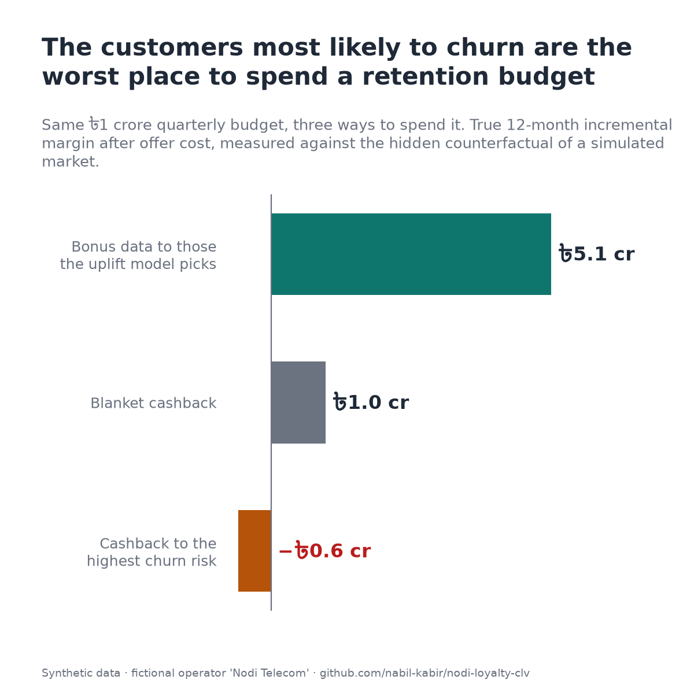
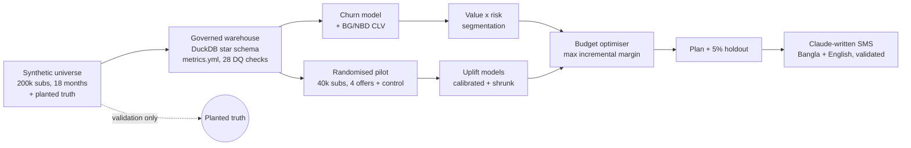
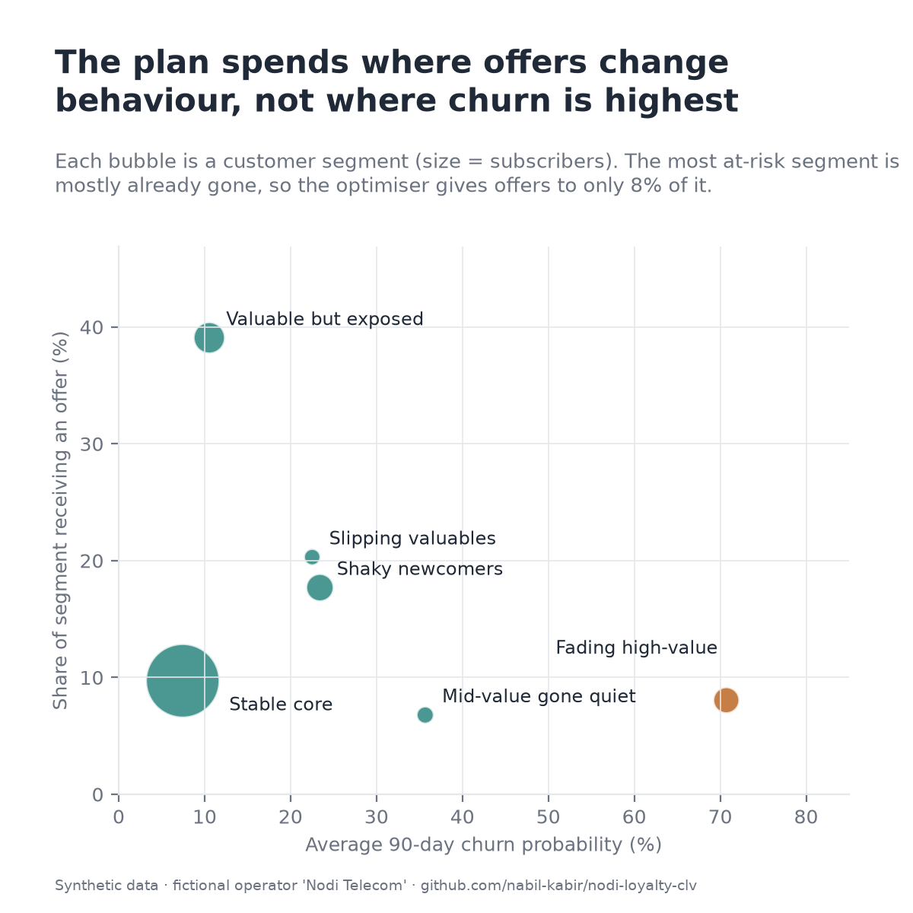
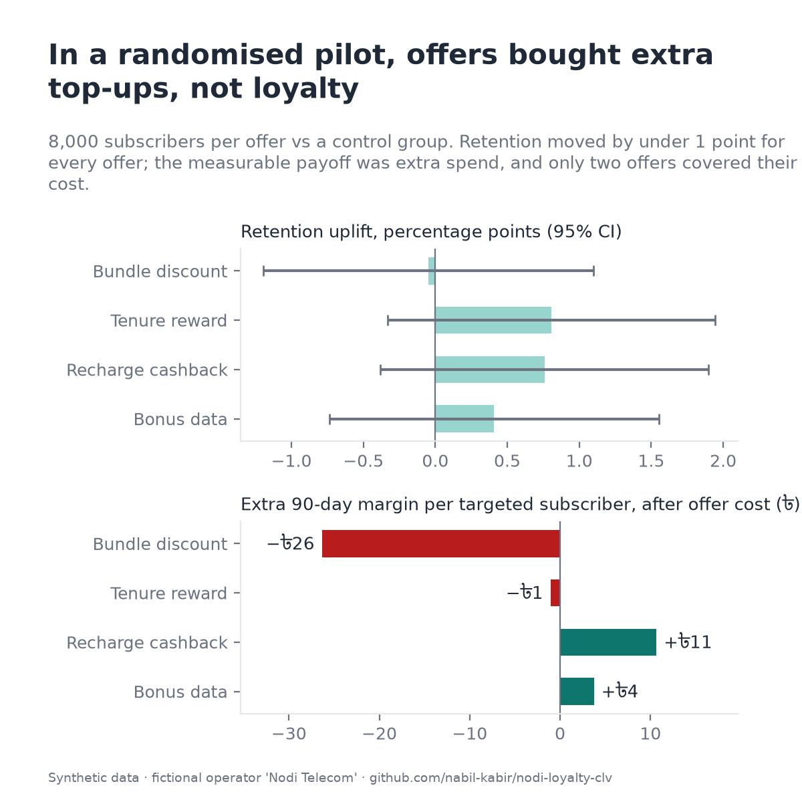
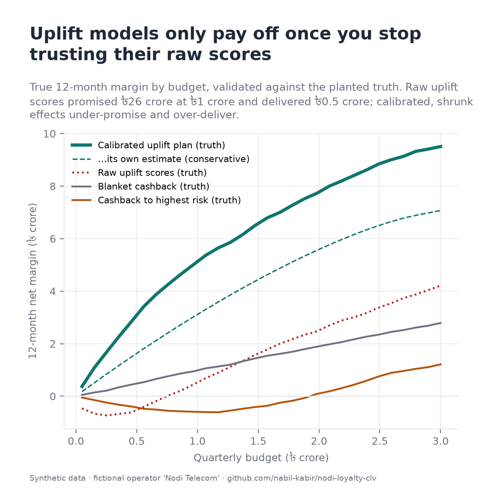

# Who to save, with what, and how to prove it

### A prepaid loyalty and CLV decision engine for a Bangladeshi mobile operator

> **Nodi Telecom is fictional and all data is synthetic.** I simulated 200,000 prepaid subscribers over 18 months and planted a hidden "ground truth". That way every model, and the final recommendation, can be checked against what really happened, which is impossible with real data.

**Live app:** _add your Streamlit link here_ · **Decisions log:** [DECISIONS.md](DECISIONS.md) · **Every number's source:** [ASSUMPTIONS.md](ASSUMPTIONS.md), [metrics.yml](metrics.yml)

---

## The question

> *If I ran loyalty at a Bangladeshi prepaid operator with a **৳1 crore quarterly retention budget**, who would I spend it on, with what offer, and how would I prove it worked?*

## The answer

**Not on the customers most likely to churn.** Sending cashback to the highest-risk subscribers *loses* money: most of them have already left in all but name. Instead, I would send **2 GB of bonus data to the 16.6 lakh subscribers whom a randomised pilot shows will respond**. That plan is expected to return **৳3.11 crore of 12-month margin after offer cost, ৳3.1 per ৳1 spent**, about 3.8× a blanket cashback. A **5% randomised holdout** proves it within one quarter.



---

## 1. The business problem

Bangladeshi prepaid is a hard place to run loyalty:

- **Small, frequent top-ups.** Recharges are mostly ৳10–50, about 4.5 a month. There is no contract to renew, so "churn" is just silence.
- **Multi-SIM by default.** Bangladesh has about 1.9 SIMs per person (GSMA). Customers rarely leave loudly; they shift their spend to the other SIM.
- **Churn is a definition, not an event.** Like BD operators, I count a subscriber as churned after **90 days without a revenue event**, with a 30-day "dormant" early warning.
- **Offers are cheap to send and easy to waste.** A blanket SMS campaign reaches people who would have stayed anyway, people who are already gone, and people the contact itself annoys into leaving.

The simulated operator has **1.32 crore active subscribers**, net ARPU of **৳148** per paying subscriber a month, and **3.2% monthly churn**. About **৳199 crore of 12-month margin** is at risk (churn probability × the value a subscriber brings if they stay).

## 2. My approach



1. **A synthetic market with a planted truth.** Hidden traits (engagement, price sensitivity, second-SIM pull, local network quality) drive the behaviour. Each subscriber has a true churn hazard, a true 12-month CLV and a true response to each offer. I deliberately made it a **hard world**: about 5% of subscribers are persuadable by a given offer, about 10% are "sleeping dogs" whom any contact pushes away, and most would stay anyway. A firewall test stops any model code from reading the truth.
2. **One definition per KPI.** 22 metrics live in [metrics.yml](metrics.yml) with SQL, a plain-English definition and an owner. Every chart and model uses them. Data quality runs 28 checks, and fault injection shows they catch all 5 planted breakages.
3. **Who is at risk, and what are they worth?**
   - **Churn:** a LightGBM model, tested strictly out of time.
   - **CLV:** BG/NBD + Gamma-Gamma, written from the likelihoods and tested by recovering known parameters, compared against a run-rate baseline.
   - **Drivers:** explained as business themes with measured contrasts, not SHAP plots.
4. **Eight segments** = value-at-risk band × churn stage (gone quiet / new / slipping / steady), each with one action.
5. **Who will respond?** Uplift models trained **only** on a randomised pilot. Past campaigns were targeted, so their results are confounded.
6. **Budget optimiser.** It maximises *incremental margin after offer cost*, not response rate, and is compared with two plans a sensible manager would run.
7. **Messages.** Claude writes SMS in Bangla and English. Offer facts are injected from structured data, and a validator rejects any wrong number, invented deadline or oversized SMS.

Every business judgement was mine, chosen from 2–3 costed options: the churn window, the ARPU definition, the risk bands, the segmentation, the budget scale, the holdout, the guardrails and the brand voice. They are logged with their trade-offs in [DECISIONS.md](DECISIONS.md).

## 3. The decision and its expected impact

| At ৳1 crore a quarter | Subscribers | Expected net 12-month margin | Per ৳1 spent |
|---|---:|---:|---:|
| **Recommended: bonus data to uplift-selected subscribers** | **16.6 lakh** | **৳3.11 crore** | **৳3.11** |
| Blanket cashback, random order | 7.9 lakh | ৳0.81 crore | ৳0.81 |
| Cashback to the highest churn risk | 8.7 lakh | ৳0.79 crore | ৳0.79 |

What drives the recommendation:

- **Offers buy spend, not loyalty.** In the pilot (8,000 subscribers per offer), no offer moved 90-day retention by more than 1 point (95% intervals ±1.1 pp). What they bought was extra top-ups: cashback added ৳23 of 90-day margin per targeted subscriber.
- **The riskiest customers are mostly already gone.** The "Fading high-value" segment holds 29% of predicted margin at risk, but the optimiser gives offers to only 8% of it. Validation later showed that over half of these subscribers had already silently churned.
- **Cheap data beats cash.** Costed at network cost (about ৳5 per GB), bonus data costs about ৳3 per targeted subscriber. At the retail face value it would lose money and the plan would switch to cashback. This is the assumption to agree with Finance first.
- **Do not run the bundle discount.** It loses about ৳26 per head, because the discount goes mostly to people who would have bought anyway.
- **Guardrail:** the two low-value segments never get paid offers, only free pack reminders.



## 4. How I would prove it worked

- **The CMO metric:** *net contribution margin per ৳1 of offer cost, measured against a randomised holdout*, read at 90 days and projected to 12 months. Retention against the holdout is tracked as a guardrail, not as the headline. A profitable campaign shouldn't be judged a failure because retention barely moves.
- **Holdout:** 5% of the selected list, about 82,800 subscribers who get nothing. With 80% power it detects an effect of **৳2.3 per subscriber**; the plan expects about ৳25. The holdout gives up about ৳15.6 lakh of expected margin, which is the price of knowing.
- **Why not prove it on the pilot?** At this budget only about 15% of the pilot would be treated, so the pilot's estimates for the competing plans overlap. The launch needs its own holdout.



## 5. Validation against the planted truth

| What was tested | Result |
|---|---|
| Churn model, out-of-time (trained Apr–Jun 2025, tested Jan 2026) | AUC 0.80. The riskiest 20% hold 60% of next quarter's churners. **Contacting as many people as today's win-back rule, it reaches 54% of churners vs 24%.** |
| Early-warning ability (subscribers still recharging) | Weaker: AUC 0.66. Most of the signal is behaviour already declining, so the campaign window is short. |
| Planted churn drivers | All 6 observable drivers recovered. Model risk ranks the 8 divisions in exactly their hidden network-quality order. |
| CLV (BG/NBD + Gamma-Gamma) vs true 12-month margin | Rank correlation 0.82 vs 0.71 for the run-rate baseline. Total bias +2.8% vs +10.8%. |
| **The plan at ৳1 crore** | Model ৳3.11 crore → **truth ৳5.12 crore**. Blanket ৳0.99 crore. Highest-risk **−৳0.60 crore**. |
| **A mistake I made and kept as a lesson** | Raw (uncalibrated) uplift scores fed to the optimiser claimed ৳26.4 crore but truly earned ৳0.53 crore. The optimiser was hunting noise. The fix was to keep personalisation only where it survives a held-out test, and to ignore effects the pilot can't tell apart from zero. |



## 6. Limitations

- **I designed the world the models are judged against.** Recovering a planted truth proves the method works when the assumptions hold. A real market will be messier: second SIMs aren't observable, feeds break, and competitors react.
- **The pilot is powered for averages, not personalisation.** With 8,000 per arm, only redemption propensity passed the personalisation test, and no retention effect was measurable. A real programme needs a bigger pilot to target on retention.
- **90-day read, 12-month claim.** Long-term effects such as discount conditioning and offer fatigue are not modelled.
- **The recommendation depends on the cost of data.** It flips from bonus data to cashback if offers are costed at face value.
- **Simplifications:** recharge is used as the revenue proxy, the VAT/SD ratios and contribution margin are approximations, CLV ignores pre-2025 tenure, and the operator is assumed to be about 13.3M active subscribers with our base as a 1% sample.
- **The SMS copy is seed copy** awaiting regeneration through the API and native-speaker review ([review/bangla_review.csv](review/bangla_review.csv)).

## 7. What I would do in my first 90 days at a real operator

**Days 1–30: definitions and economics.**
- Agree churn, active base and ARPU with Finance and BI, one definition each.
- Audit the recharge, usage, CRM and campaign-history feeds.
- Measure today's win-back rule against a holdout, if one exists.
- Settle the real marginal cost of data and minutes with the network and finance teams. The recommendation depends on it.

**Days 31–60: a pilot designed to answer the money question.**
- Run a randomised pilot with a no-contact control, sized by power calculation to detect personalised effects, not just averages.
- Build churn and CLV models on real data and backtest them against the current rule.
- Set contact-frequency guardrails to protect the sleeping dogs.

**Days 61–90: launch, measure, institutionalise.**
- Read the pilot and calibrate uplift.
- Launch the first optimised wave with a 5% holdout and a CMO dashboard on net margin per ৳.
- Hand regional churn drivers to the network team, because some churn is a coverage problem, not a marketing one.
- Queue the next experiments: onboarding for new SIMs and the quality of activation-kiosk acquisitions.

---

## Repository map

| Path | What |
|---|---|
| `run.py` | One command rebuilds everything |
| `config.yaml`, `metrics.yml`, `segments.yml`, `messaging.yml` | Every tunable number, KPI definition, segment rule and brand rule |
| `src/nodi/simulate` | Synthetic market and planted truth |
| `src/nodi/warehouse`, `src/nodi/metrics.py` | DuckDB star schema, governed metrics, data quality |
| `src/nodi/models` | Churn (LightGBM) and CLV (BG/NBD + Gamma-Gamma) |
| `src/nodi/segments`, `src/nodi/offers` | Segmentation, uplift models, optimiser, experiment design |
| `src/nodi/messaging` | SMS generation, validators, cache |
| `src/nodi/validate` | The **only** code allowed to read the planted truth |
| `app/` | Streamlit app (reads `app_data/` only) |
| `reports/` | Per-phase summaries and charts |
| `DECISIONS.md`, `ASSUMPTIONS.md` | Every choice, trade-off and assumption |

## Setup

Requires Python 3.11+ (built on 3.14).

```bash
python -m venv .venv
.venv/Scripts/pip install -r requirements.txt        # Windows (macOS/Linux: .venv/bin/pip)
python run.py                                        # full rebuild, ~20 minutes
python run.py --sample                               # 20k-subscriber build into data_sample/
python -m pytest                                     # 71 tests
streamlit run app/streamlit_app.py                   # the app (reads app_data/, no API key needed)
```

**Campaign SMS** run in mock mode from a committed cache by default. To generate them with Claude, set `ANTHROPIC_API_KEY` and run `python run.py --only messages --live`. The model is configurable in `config.yaml` (default `claude-sonnet-5-5`).

**Deploy the app (Streamlit Community Cloud):** sign in at share.streamlit.io, then choose *Create app* → repository `nabil-kabir/nodi-loyalty-clv`, branch `main`, main file `app/streamlit_app.py`. Under *Advanced settings*, pick Python 3.12 or later. The app installs only `app/requirements.txt` and needs no secrets.
